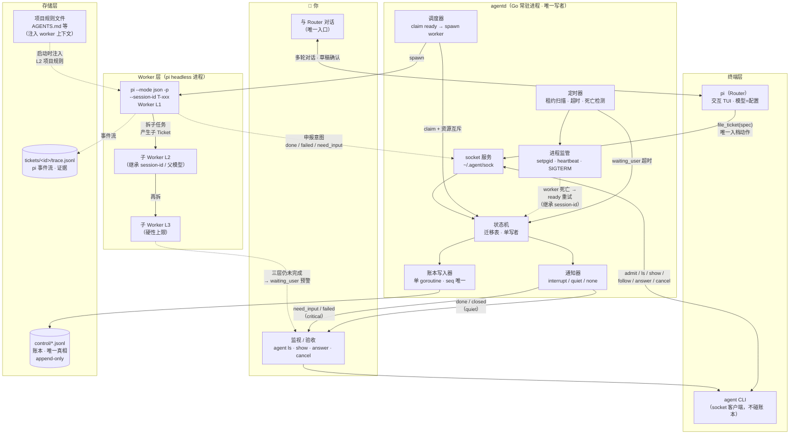
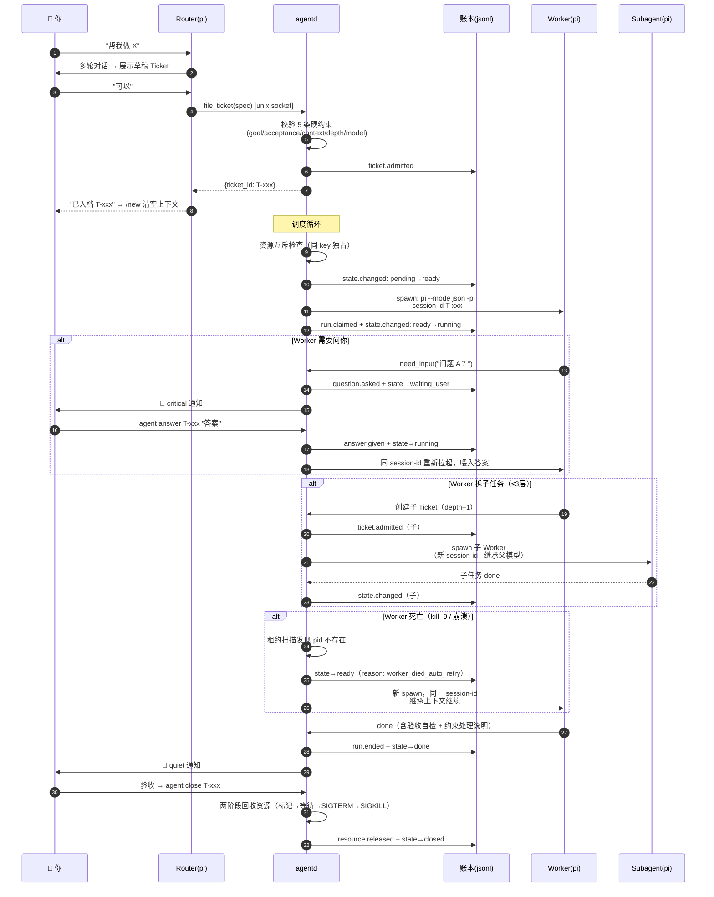
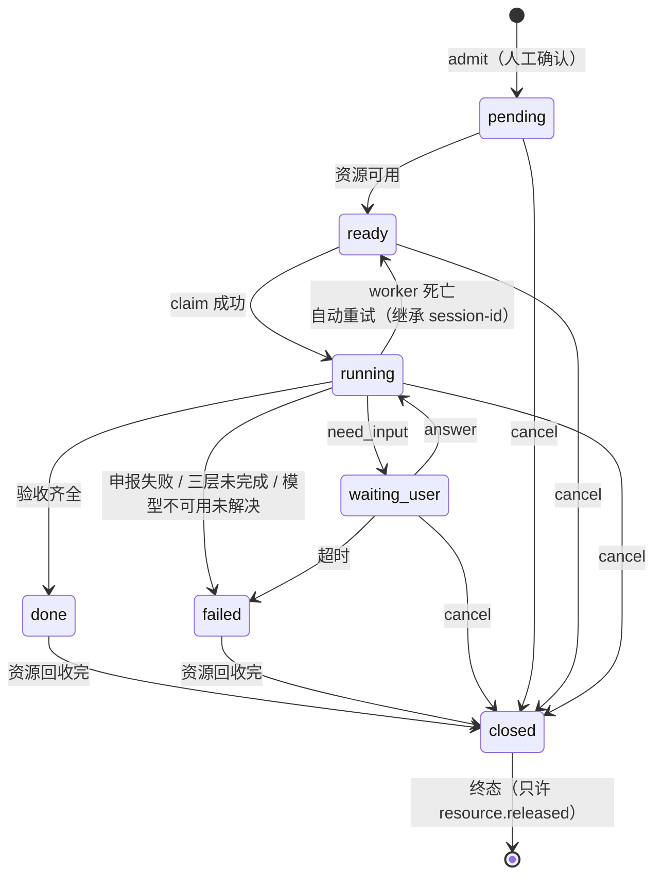
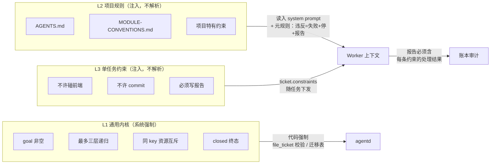
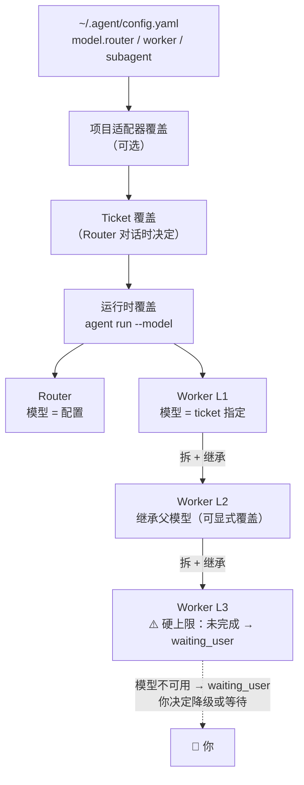
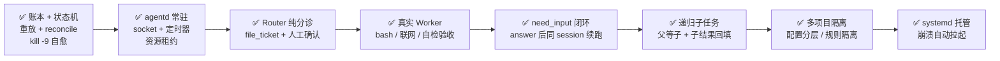

# super_personal_agent — 系统架构图

> 对应 DESIGN.md v0.3。本文档只画图，不重复设计理由。

---

## 1. 总体拓扑

---

## 2. 一张 Ticket 的完整生命周期

---

## 3. 状态机（M0 已实现）

---

## 4. 三层约束注入

---

## 5. 模型与递归（部署决策，不进内核）

---

## 6. 已实现能力

详细交互版架构图：**[architecture.html](architecture.html)**
